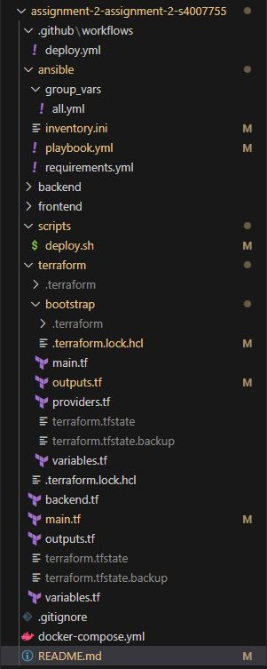
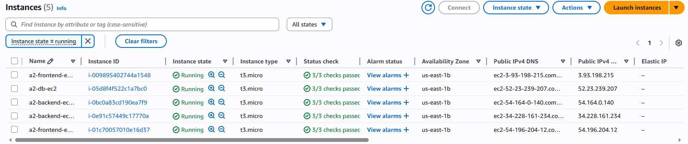
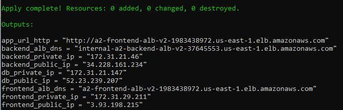
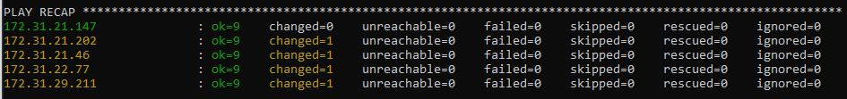
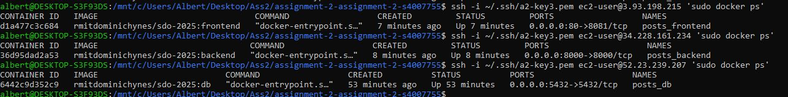
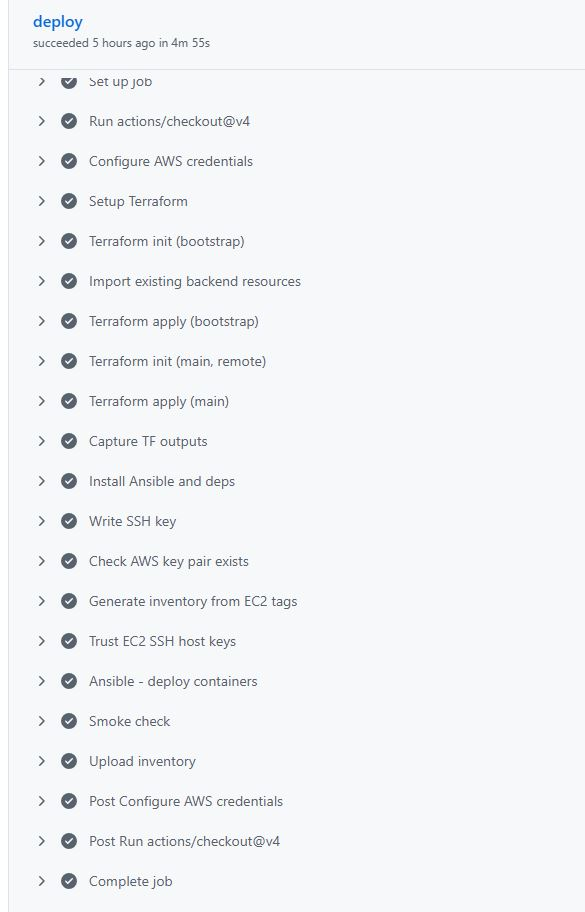
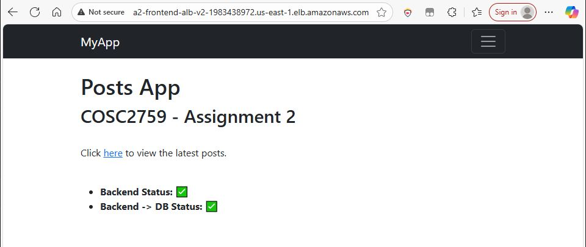
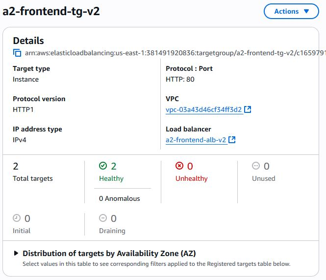

# COSC2759 Assignment 2 - Semester 2, 2025

# Services


## Backend
This is the Backend Posts Service. It is responsible for talking to the Posts DB, and exposing an internal HTTP API for managing Posts.

### Environment Variables
| Environment Variable | Purpose                                                 |
|----------------------|---------------------------------------------------------|
| PORT                 | Which port will the service listen on for HTTP requests |
| DB_USER              | Username for connecting to the Backend DB               |
| DB_PASSWORD          | Password for connecting to the Backend DB               |
| DB_HOST              | Hostname/Network address for the Backend DB             |

### Image
The Backend service image is available at `rmitdominichynes/sdo-2025:backend`.

### Dependencies
The Backend service depends on a PostgreSQL database, with the required migrations. An image for this has been provided, available at `rmitdominichynes/sdo-2025:db`.

### Database Configuration
The PostgreSQL Database container also requires some environment variables to be configured.

|  Environment Variable        |  Purpose                                                  |
|------------------------------|-----------------------------------------------------------|
|  POSTGRES_USER               | Username for the Backend Service to use to connect        |
|  POSTGRES_PASSWORD           | Password for the Backend Service to use to connect        |
|  POSTGRES_DB                 | "posts"                                                   |

## Frontend
This is the Frontend Posts Service. It is responsible for serving a UI to users over HTTP. This UI allows them to view and manage Posts.

### Environment Variables
| Environment Variable | Purpose                                                 |
|----------------------|---------------------------------------------------------|
| PORT                 | Which port will the service listen on for HTTP requests |
| BACKEND_URL          | Fully qualified URL for reaching the Backend Service    |

### Image
The Frontend service image is available at `rmitdominichynes/sdo-2025:frontend`.


# Running The Services Locally (In Docker)
1. Run `docker compose up -d` to start the two services, and a postgres database container.
2. View the Frontend Posts Service at `http://localhost:8081`, and the Backend Posts Service at `http://localhost:8080`.

# Deploying The Services

The services can be deployed to EC2. 

Each container needs: 
- The correct environment variables configured (refer to the above sections)
- Security Groups will need to be configured to allow traffic to reach the instances. 
    - They will also need to be configured to allow the instances to talk to each other, if the services are deployed on different instances.
    - The PostgreSQL database receives inbound traffic on port `5432`
    - The ports used by the Backend and Frontend services are configurable through the `PORT` environment variable. Otherwise, it will default to port `8081`.

---


# Automated Deployment, Architecture, and Verification

This project automates the deployment of Yeetcode Inc.’s Posts application to AWS using Terraform, Ansible and GitHub Actions.  
It provisions infrastructure, configures EC2 instances and deploys containerized Frontend, Backend and Database services in a reproducible, secure and fully automated way.

## Overview

The solution implements a three tier AWS architecture with separate layers for web, application and data:

| Layer | Purpose | Technology |
|-------|----------|-------------|
| **Frontend** | Public facing UI served via Load Balancer | EC2 ×2, Docker, ALB (public) |
| **Backend** | Internal API and business logic layer | EC2 ×2, Docker, ALB (internal) |
| **Database** | Persistent PostgreSQL data store | EC2 ×1, Docker |
| **Networking** | NAT Gateway, Subnets, Bastion Host | VPC with public/private subnets |
| **Automation** | Infrastructure & configuration deployment | Terraform, Ansible and GitHub Actions |
| **State Management** | Remote backend storage | S3 and DynamoDB |

**Traffic flow:**  
`User -> Frontend ALB -> Frontend EC2 -> Backend ALB -> Backend EC2 -> PostgreSQL Database`


## Networking, NAT Gateway and Bastion Host

To ensure a secure, production-grade AWS network, the infrastructure uses a custom VPC with public and private subnets, a NAT Gateway and a bastion host.

### Network Topology

| Component | CIDR | Description |
|------------|------|-------------|
| **VPC** | `172.31.0.0/16` | The main network boundary for all resources |
| **Public Subnets** | `172.31.80.0/20`, `172.31.64.0/20` | Contain frontend EC2 and bastion host |
| **Private Subnets** | `172.31.0.0/20`, `172.31.16.0/20`, `172.31.32.0/20`, `172.31.48.0/20` | Contain backend and DB instances |
| **NAT Gateway** | Deployed in a public subnet | Allows private EC2s to reach the internet securely |
| **Internet Gateway** | Attached to VPC | Enables public connectivity for public subnets |

### How it Works

- **Public Subnets** -> Route 0.0.0.0/0 via the Internet Gateway
- **Private Subnets** -> Route 0.0.0.0/0 via the NAT Gateway  
- **Bastion Host** -> Used for SSH access to backend and database instances inside private subnets  
- **Backend and DB Instances** -> Have no public IPs, ensuring a secure, private deployment

### Bastion (Jump Host)

A bastion host is created in a public subnet and acts as the secure gateway to reach private EC2 instances.  
All SSH and Ansible traffic for the backend and database goes through this bastion host via the `ProxyCommand` setting in the dynamic inventory:

```ini
[db:vars]
ansible_ssh_common_args='-o IdentitiesOnly=yes -o IdentityFile=~/.ssh/a2-key3.pem -o ProxyCommand="ssh -i ~/.ssh/a2-key3.pem -o IdentitiesOnly=yes -W %h:%p ec2-user@<bastion-public-ip>"'

[backend:vars]
ansible_ssh_common_args='-o IdentitiesOnly=yes -o IdentityFile=~/.ssh/a2-key3.pem -o ProxyCommand="ssh -i ~/.ssh/a2-key3.pem -o IdentitiesOnly=yes -W %h:%p ec2-user@<bastion-public-ip>"'
```

This ensures secure access without exposing private IPs to the internet.


## Security Groups

| Security Group | Inbound | Source | Purpose |
|----------------|----------|---------|----------|
| **Frontend SG** | 22 (SSH), 80 (HTTP) | `0.0.0.0/0` | Public access |
| **Backend SG** | 8000 | Frontend SG | Internal communication only |
| **DB SG** | 5432 | Backend SG | Database traffic only from backend |

This enforces principle of least privilege and isolates network tiers.


## Terraform Configuration

Terraform provisions:
- VPC, Subnets, Route Tables
- NAT Gateway and Internet Gateway
- EC2 Instances (Frontend, Backend, DB, Bastion)
- Security Groups
- Application Load Balancers
- Remote Backend (S3 and DynamoDB)

Remote state configuration:
```hcl
terraform {
  backend "s3" {
    bucket         = "a2-terraform-state-s4007755"
    key            = "terraform/state.tfstate"
    region         = "us-east-1"
    dynamodb_table = "a2-terraform-locks"
  }
}
```


## Ansible Configuration

After Terraform deploys the infrastructure, Ansible automates instance setup:
- Installs Docker and dependencies
- Pulls required images (`frontend`, `backend`, `db`)
- Creates a Docker network (`posts_net`)
- Starts containers with proper environment variables

Example playbook tasks:
```yaml
- name: Run Frontend container
  docker_container:
    name: frontend
    image: rmitdominichynes/sdo-2025:frontend
    ports:
      - "80:80"
    env:
      BACKEND_URL: "http://{{ backend_private_ip }}:8000"
```


## How to Deploy (Local)

Before running Terraform or Ansible locally, configure your AWS CLI session:

### Step 1 Configure AWS CLI with your current temporary credentials
```bash
aws configure set aws_access_key_id     "<aws_access_key_id>"
aws configure set aws_secret_access_key "<aws_secret_access_key>"
aws configure set aws_session_token     "<aws_session_token>"
aws configure set region                us-east-1

aws sts get-caller-identity # Verification command
```

> Temporary AWS Academy credentials expire every 4 hours, reconfigure them if Terraform fails due to authentication errors.


### Step 2 Set your SSH key name and path

Note: I’m using the a2-key3 SSH key located in ~/.ssh/a2-key3.

In scripts/deploy.sh:
```bash
# EC2 key pair name in AWS
export KEY_NAME="a2-key3" # Change KEY_NAME to your key name

# Local private key file path
export ANSIBLE_SSH_KEY="$HOME/.ssh/a2-key3" # Change ANSIBLE_SSH_KEY to match your key directory if different
```

### Step 3 Run the one shot deployment script
```bash
chmod +x scripts/deploy.sh
./scripts/deploy.sh
```

#### What it does:
1. Bootstraps S3/DynamoDB for remote Terraform state.
2. Applies the main Terraform stack (VPC bits, subnets, NAT, EC2s, ALBs, SGs).
3. Reads outputs.
4. Generates a dynamic Ansible inventory.
5. Runs the Ansible playbook across the fleet.
6. Performs a smoke check against the Frontend ALB.

## How to Deploy (GitHub Actions)
A workflow at `.github/workflows/deploy.yml` deploys infrastructure and app on push to main or via manual workflow_dispatch.

### Set Repository Secrets
| Secret Name | Description |
|--------------|--------------|
| `AWS_ACCESS_KEY_ID` | Temporary access key |
| `AWS_SECRET_ACCESS_KEY` | Temporary secret key |
| `AWS_SESSION_TOKEN` | Temporary session token |
| `AWS_REGION` | Region (`us-east-1`) |
| `TF_STATE_BUCKET` | Terraform state bucket |
| `TF_LOCK_TABLE` | DynamoDB lock table |
| `EC2_SSH_KEY_PEM` | Contents of PEM key |

Then trigger Deploy from the Actions tab or push to main.

Workflow highlights:
- Imports S3/DynamoDB if pre existing, applies bootstrap.
- Initializes remote backend and applies main Terraform.
- Captures TF outputs.
- Builds dynamic inventory with bastion jump.
- Runs Ansible to deploy containers.
- Smoke test hits the Frontend ALB.


## How to Deploy (Manual - Terraform and Ansible)

Before running Terraform or Ansible commands, configure your AWS credentials and SSH key.

### Step 1
These credentials are needed for Terraform to access AWS.  
Run the following commands in your terminal:

```bash
aws configure set aws_access_key_id     "<aws_access_key_id>"
aws configure set aws_secret_access_key "<aws_secret_access_key>"
aws configure set aws_session_token     "<aws_session_token>"
aws configure set region                us-east-1

aws sts get-caller-identity  # Verification command
```

> Temporary AWS Academy credentials expire every 4 hours, reconfigure them if Terraform fails due to authentication errors.

### Step 2 Set Up Your SSH Key (Manual Deployment)

Point Ansible/SSH directly at your private key file (e.g., `~/.ssh/a2-key3.pem`) and ensure proper permissions:

```bash
chmod 600 ~/.ssh/a2-key3.pem
```

You can provide the key to Ansible in any one of these ways:

**Option A - inventory.ini (recommended)**
```ini
[all:vars]
ansible_user=ec2-user
ansible_ssh_private_key_file=~/.ssh/a2-key3.pem # Change to your key or path name
```

**Option B - ansible.cfg**
```ini
[defaults]
private_key_file = ~/.ssh/a2-key3.pem # Change to your key or path name
remote_user = ec2-user
```

**Option C - CLI flag (per run)**
```bash
ansible-playbook -i inventory.ini playbook.yml --private-key ~/.ssh/a2-key3.pem -u ec2-user # Change to your key or path name
```

### Step 3 - Deploy Infrastructure with Terraform

Navigate to the Terraform directory and execute the following:

```bash
cd terraform/

# Initialize Terraform
terraform init

# Validate syntax and configuration
terraform validate

# Preview infrastructure plan
terraform plan

# Apply configuration
terraform apply -auto-approve
```

After completion, view outputs to obtain EC2 IPs and ALB URLs:

```bash
terraform output
```

These outputs are used by Ansible for configuration.

### Step 4 - Configure EC2 Instances with Ansible

After Terraform completes, switch to your Ansible directory:

```bash
cd ansible/
```

Ensure the inventory.ini file references Terraform outputs for backend, frontend and DB.

Then run the playbook:

```bash
# Deploy across all instances
ansible-playbook -i inventory.ini playbook.yml
```

To verify Ansible connectivity before deploying:
```bash
ansible all -i inventory.ini -m ping
```


## Verification

| Component | Verification Method |
|------------|----------------------|
| **Frontend** | Visit `http://$(terraform output -raw frontend_alb_dns)` |
| **Backend** | Test from frontend EC2 via curl |
| **Database** | Connect from backend EC2 internally |
| **NAT Gateway** | Check outbound access via `curl https://example.com` from backend instance |
| **SSH Access** | Only via Bastion |


## Cleanup (Tear Down Infrastructure)

When finished testing, remove all AWS resources to avoid costs:

```bash
cd terraform/
terraform destroy -auto-approve
```


## Results

- Terraform deployed 5 EC2 instances, 2 ALBs, 1 NAT Gateway  
- Ansible installed Docker and deployed containers  
- All services healthy in AWS console  
- Frontend accessible publicly via ALB  
- Backend and DB accessible only internally  


## Screenshots

Below are the key verification screenshots demonstrating successful deployment and automation of the Yeetcode Inc. Posts application on AWS:

| Screenshot | Description |
|-------------|--------------|
|  | Repository structure showing directories for Terraform, Ansible and GitHub Actions. |
|  | AWS Console confirming 5 EC2 instances deployed (Frontend ×2, Backend ×2, DB ×1). |
|  | Terraform output verifying successful creation of networking components and EC2s. |
|  | Ansible execution log confirming Docker installation and container deployment. |
|  | Docker container validation proving all services (frontend, backend, db) are running. |
|  | GitHub Actions workflow confirming automated CI deployment success. |
|  | Frontend UI accessible through public ALB DNS. |
|  | AWS Target Groups showing healthy backend and frontend instances. |


## Troubleshooting

Common issues and their fixes when deploying the Posts application:

| Issue | Cause | Solution |
|--------|--------|-----------|
| **SSH or Ansible connection timeout** | Bastion host or private key misconfigured | Ensure the correct PEM key is specified in `ansible_ssh_common_args` and the bastion's public IP is up to date. |
| **Terraform state lock error** | Previous Terraform run did not unlock DynamoDB state | Run `terraform force-unlock a2-tf-locks-s4007755` or wait for the state to be released automatically. |
| **GitHub Actions deployment fails** | Missing or expired AWS credentials | Re add valid temporary credentials to repository secrets (`AWS_ACCESS_KEY_ID`, `AWS_SECRET_ACCESS_KEY`, `AWS_SESSION_TOKEN`). |

> Run `terraform output` to quickly verify resource IPs, ALB DNS names and subnet configurations.


## Summary

- Automated provisioning and configuration using Terraform, Ansible and GitHub Actions 
- VPC with NAT Gateway and bastion host for secure, private networking  
- Scalable, modular 3 tier AWS architecture 
- Remote Terraform state with S3 and DynamoDB  
- Zero manual steps beyond triggering the workflow  


**Author:** Albert Zubovic S4007755
**Course:** COSC2759 - Systems Deployment and Operations  
**University:** RMIT University  
**Semester:** 2, 2025