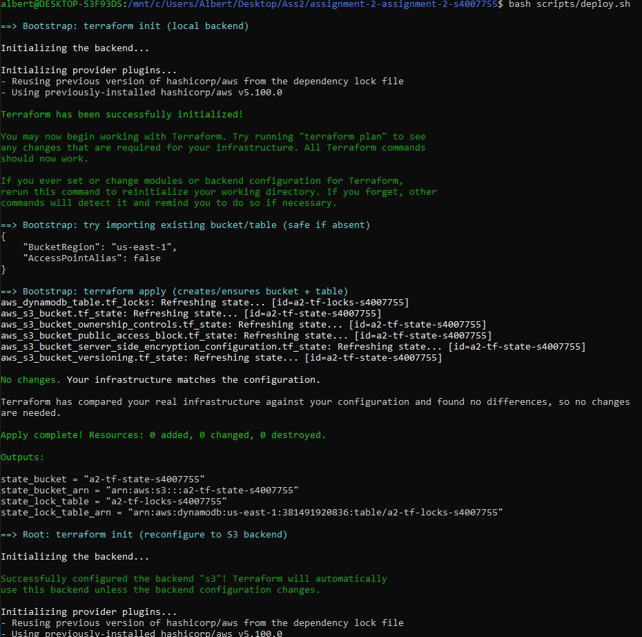
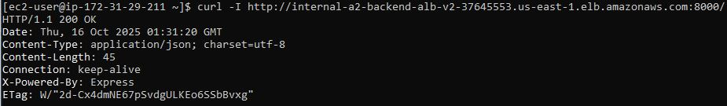

# COSC2759 Assignment 2 - Semester 2, 2025

# Services


## Backend
This is the Backend Posts Service. It is responsible for talking to the Posts DB, and exposing an internal HTTP API for managing Posts.

### Environment Variables
| Environment Variable | Purpose                                                 |
|----------------------|---------------------------------------------------------|
| PORT                 | Which port will the service listen on for HTTP requests |
| DB_USER              | Username for connecting to the Backend DB               |
| DB_PASSWORD          | Password for connecting to the Backend DB               |
| DB_HOST              | Hostname/Network address for the Backend DB             |

### Image
The Backend service image is available at `rmitdominichynes/sdo-2025:backend`.

### Dependencies
The Backend service depends on a PostgreSQL database, with the required migrations. An image for this has been provided, available at `rmitdominichynes/sdo-2025:db`.

### Database Configuration
The PostgreSQL Databse container also requires some environment variables to be configured.

|  Environment Variable        |  Purpose                                                  |
|------------------------------|-----------------------------------------------------------|
|  POSTGRES_USER               | Username for the Backend Service to use to connect        |
|  POSTGRES_PASSWORD           | Password for the Backend Service to use to connect        |
|  POSTGRES_DB                 | "posts"                                                   |

## Frontend
This is the Frontend Posts Service. It is responsible for serving a UI to users over HTTP. This UI allows them to view and manage Posts.

### Environment Variables
| Environment Variable | Purpose                                                 |
|----------------------|---------------------------------------------------------|
| PORT                 | Which port will the service listen on for HTTP requests |
| BACKEND_URL          | Fully qualified URL for reaching the Backend Service    |

### Image
The Frontend service image is available at `rmitdominichynes/sdo-2025:frontend`.


# Running The Services Locally (In Docker)
1. Run `docker compose up -d` to start the two services, and a postgres database container.
2. View the Frontend Posts Service at `http://localhost:8081`, and the Backend Posts Service at `http://localhost:8080`.

# Deploying The Services

The services can be deployed to EC2. 

Each container needs: 
- The correct environment variables configured (refer to the above sections)
- Security Groups will need to be configured to allow traffic to reach the instances. 
    - They will also need to be configured to allow the instances to talk to each other, if the services are deployed on different instances.
    - The PostgreSQL database receives inbound traffic on port `5432`
    - The ports used by the Backend and Frontend services are configurable through the `PORT` environment variable. Otherwise, it will default to port `8081`.

---


# Automated Deployment, Architecture, and Verification

This project automates the deployment of Yeetcode Inc.’s **Posts application** to AWS using **Terraform**, **Ansible**, and **GitHub Actions**.  
It provisions infrastructure, configures EC2 instances and deploys containerized Frontend, Backend and Database services in a reproducible, secure and fully automated way.


---

## Overview

The solution implements a three tier architecture with a load balanced, multi instance setup:

| Layer | Purpose | Technology |
|-------|----------|-------------|
| Frontend | Serves UI to users via a public load balancer | EC2 ×2, Docker, ALB (public) |
| Backend | Processes API requests, communicates with the database | EC2 ×2, Docker, ALB (internal) |
| Database | Stores application data persistently | EC2 ×1, Docker (PostgreSQL) |
| State Management | Stores Terraform state remotely | S3 + DynamoDB |
| Automation | Handles provisioning and configuration | Terraform, Ansible and GitHub Actions |

**Traffic flow:**  
`User -> Frontend ALB -> Frontend containers -> Backend ALB -> Backend containers -> PostgreSQL DB`


---

## Infrastructure and Deployment

### Terraform

Terraform provisions:
- EC2 instances for Frontend, Backend and Database
- Security Groups defining clear network boundaries
- Application Load Balancers for both Frontend and Backend tiers
- Remote backend using S3 and DynamoDB for state management and locking


**Security Groups**
- **Frontend SG**: Allows inbound HTTP (80) and SSH (22)  
- **Backend SG**: Allows inbound 8000 only from Frontend SG  
- **DB SG**: Allows inbound 5432 only from Backend SG  

**Remote Backend Configuration**
```hcl
terraform {
  backend "s3" {
    bucket         = "a2-terraform-state-s4007755"
    key            = "terraform/state.tfstate"
    region         = "us-east-1"
    dynamodb_table = "a2-terraform-locks"
  }
}
```

---

## Ansible Configuration

Ansible installs Docker, pulls the required images, creates a Docker network (`posts_net`) and starts the containers with appropriate environment variables.


### Containers

**Database Container**
- Image: `rmitdominichynes/sdo-2025:db`
- Exposed only internally on port `5432`

**Backend Container**
- Image: `rmitdominichynes/sdo-2025:backend`
- Exposed on port `8000`
- Connects to DB via private IPs

**Frontend Container**
- Image: `rmitdominichynes/sdo-2025:frontend`
- Exposed publicly on port `80`
- BACKEND_URL set to `http://<backend-private-ip>:8000`


---

## Deployment Scripts

### `scripts/deploy.sh`
Automates infrastructure provisioning and configuration:

1. Runs Terraform init and apply  
2. Generates dynamic Ansible inventory  
3. Executes Ansible deployment  



**Key Features**
- Uses AWS profile (`academy`) - no credentials hardcoded  
- Clean structure with clear comments  
- Safe to re run

---

## GitHub Actions Workflow

The `.github/workflows/deploy.yml` automates the full deployment pipeline.


**Triggers**
- Push to `main`
- Manual dispatch via Actions UI

**Steps**
- Configure AWS credentials via GitHub Secrets  
- Terraform apply  
- Generate Ansible inventory  
- Run Ansible playbook

---

## Verification

**Frontend:**  
Accessible via the Frontend ALB on port 80  
```bash
curl -I http://$(terraform output -raw frontend_alb_dns)
```


**Backend:**  
Accessible only internally via Backend ALB  


**Database:**  
Private; accessible only from Backend instance.  

---

## Troubleshooting

| Issue | Cause | Fix |
|-------|--------|-----|
| SSH denied | PEM permissions wrong | `chmod 600 ~/.ssh/a2-key3.pem` |
| No space | Small root volume | Set 20GB in Terraform |
| 502 on /health | Containers booting | Wait and retry |
| Missing ports | Incorrect published_ports | Fix playbook vars |


---

## Summary

- Automated Terraform, Ansible and GitHub Actions deployment  
- Multi tier AWS architecture with ALBs  
- Secure network boundaries between layers  
- Remote backend (S3 and DynamoDB)  
- Public FE, private BE and DB  
- Meets all assignment requirements

---

*Author: Albert Zubovic (s4007755)*  
*Course: COSC2759 Systems Deployment and Operations, RMIT University, Semester 2 2025*